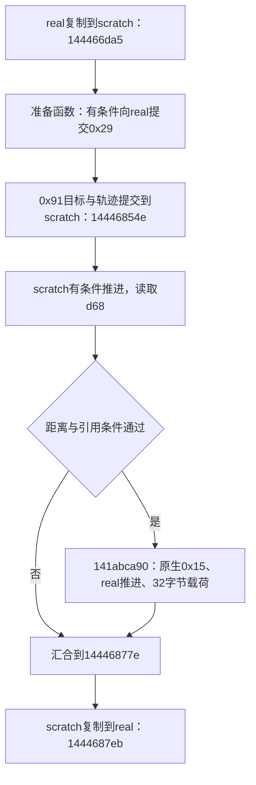

# FM2024：试算提交与射门记录时序

研究日期：20261017。目标为 Steam Windows `fm.exe`，`24.4.2+2081827`，基址 `0x140000000`。仅原程序静态分析，不执行游戏、读取运行内存、测试存档或使用第三方编辑器材料。

## 本轮结论

0x91的一条路径在试算提交之后、正式球复制之前，按试算球的引用条件调用记录函数。该函数先生成原生事件0x15，随后有条件推进正式球，再生成另一个32字节载荷。因此，记录函数不是状态不变的旁观者；也不能无条件把其观测值视作刚生成的试算轨迹值。

原生0x15可接到此前恢复的 `end_shot_*` 分析标签。这将动作含义收窄为“0x91存在射门记录路径”，但没有恢复所有0x91执行的统一官方名称，也没有将记录分类当作决定进球的概率公式。

## 证据和记号

与[提交前速度边界](20261017_方向检查与提交前速度边界.md)共用[原生指令](20261017_action91_record_order_static.txt)、[字节窗口及33个局部算例](20261017_action91_record_order_observations.json)。使用已有只读Ghidra与原PE/objdump，不是完整REA native dossier。

P为球员，M为比赛对象，S=*(M+d2b0)，R=*(M+d2b8)。下文用scratch/real区分两个字段的角色；必须保留实际对象绑定，不能仅凭字段名证明任意输入下两者不别名。原生事件、分析标签、32字节载荷和动作编号是不同数据。

## 调用顺序与记录门槛

本轮连接的顺序是：



图中B只表示准备函数有该分支，不表示每次都执行0x29。还存在其他中间记录与状态调用；图只展示本轮关注的顺序。

在 `14446856c` 的局部入口，距离D>12f跳过本段记录；否则在 `144468590` 检查scratch的d68。只要d68为空、d63非零且d62为0，就调用 `1443ea8f0(S,1)`，随后重读。退出后，将d68与P+1d0比较，不相等就跳过记录函数；相等才继续写局部上下文并在 `144468779` 调用 `141abca90(M,P)`。

这里的d68是对象引用，不直接命名为“射门成功”。D是执行器此前的场地参考距离，不是无条件等于目标与球的距离。执行器最初进入这一分支要求D<12；本处指令为D<=12，算例中的D=12只验证局部门槛，不证明完整函数以该输入到达这里。

最小例子固定在这个局部入口且试算推进已经结束：D=11、S+d68=P+1d0，进入记录；只改d68为另一引用则跳过。两条路径随后都可汇合到正式球复制，故“没生成这次记录”不等于“整个动作没有提交球状态”。

## 原生0x15的生产者连接

`141abca90` 在入口把第四参数设为0x15、第三参数设为0，调用 `141aac200`。该包装函数把第四参数转成 `141b5e4e0` 的第三参数；后者继续调用 `1419fff30`，由 `141a000a4` 写入新记录+68的类型字节。

```text
0x91条件路径
→ 141abca90(M,P)
→ 141aac200(M,P,0,0x15,flags)
→ 141b5e4e0(P,&record,0x15,0)
→ 1419fff30(...,0x15,...)
→ native_record+68 = 0x15
```

入口附加标志为 `(M+9e8 < M+a3c+40 ? 0x4000 : 0)`；不为这个未完全具名的时间条件添加比赛术语。第三参数0在既有构造路径中使用球员位置，不能命名为success=false。

[已有原生事件转换证据](20261015_扑救事件类型与射门被扑救分类.md)确认：当前记录类型0x15，经关联事件选择和第二参数转换，可得到 `end_shot_missed_target`、`end_shot_hit_woodwork`、`end_shot_saved`、`end_shot_blocked`、`end_shot_gone_in`。本轮复用该映射，不把0x15当分析编号21直接查名字。

这不是说本轮记录已归入某个结果。仍须经过记录关联、修订、状态与正式分析提交；“生成0x15”不能当作射正或进球标签。

## 记录函数内推进的是real

`141abccf2` 清M+d4ae后，`141abccfc`附近从M+d2b8取球对象。以下四组调用的接收者均沿这个real绑定，而不是scratch字段：

| 读取位置 | 首次进入推进循环的条件 |
| --- | --- |
| R+da0 | 引用为空、R+d63!=0、R+d62==0 |
| R+da8 | 引用为空、R+d63!=0、R+d62==0 |
| R+d24 | 值恰好−1、R+d64==0、R+d62==0 |
| R+d68 | d24分支非负，引用为空、R+d63!=0、R+d62==0 |

每次调用 `1443ea8f0(R,1)` 后重读相应值，决定是否继续。第三组条件没有读取d63，不得把四组统一成一个相同谓词。各组之间还会重新读取M+d2b8或状态字节。

最小例子：d24=−1、d64=0、d62=0会进入第三组；只改d24为−2则不进入该循环。这个例子验证精确哨兵值，不执行推进函数、不预测迭代次数。d24=−2仍属于后面的负值分类分支。

当S与R是不同对象、且没有其他代码把试算状态提前复制到R时，这些调用读取和推进的是当时的real状态，不能直接当成本次scratch的结果。它们可能改变real；随后复制scratch也不代表已经撤销记录函数对M、记录集合或计数的其他写入。

## 负值分支的标志与另一载荷

在推进后的分类入口，若R+d24<0：

```text
R+da0与R+da8均为空：M+d4ae=0x8000，二维载荷位模式为0
否则：
    若R+da0非空：M+d4ae=0x1000
    否则若M+8e00与M+8e04同为正或同为负：M+d4ae=0x80
    否则：M+d4ae=0x08
    载荷两个float = (M+8e00的值, M+8e08的值)
```

这些值以指令分支和字段位置描述，不擅自命名为进球/无效进球/射偏判据。非负d24路径另有位置与范围分类，本轮没有把全部位掩码具名。

最小例子：d24=−2、da0=da8=0，得到标志0x8000、载荷(0,0)。仅将da8设为非空，并固定M+8e00=2、M+8e04=3、M+8e08=5，得到0x80及载荷(2,5)；把M+8e04改为−3则变为0x08，载荷仍(2,5)。这验证符号组合与载荷来源，不验证球是否进入球门。

`141abd116..141abd175` 分配0x20字节对象，写虚表1456b11b8、+08标志word、+0a当前时刻低16位、+10的两个float，以及两个其他字节，再用分类号0x15传给 `1443d5fa0(M+778,...)`。时间65535写入65535、65536写入0，是该载荷的窄字段写入，不意味着比赛时钟本身回绕。

这个32字节对象与前面带+68类型字段的原生事件不是同一个布局。虽然这里也使用0x15，仍不能假定已经恢复二者完整关联规则。

## 任务状态与后续

已回答：一条0x91路径如何产生射门相关原生记录；提交与正式复制之间的条件推进对象；负值分支与载荷字段。部分回答：动作业务含义。未回答：统一官方动作名、所有动作准入、完整记录关联及最终比赛结果。

下一步优先跟踪这份32字节载荷的真实消费者，确认M+d4ae及其复制字段是展示分类、分析输入还是还会改变比赛状态；同时继续闭合准备函数对球和行动块的具体写入。当前证据不能用于全场属性排名或进球概率。

无新增核心概念。本次未发现可安全删除项。
