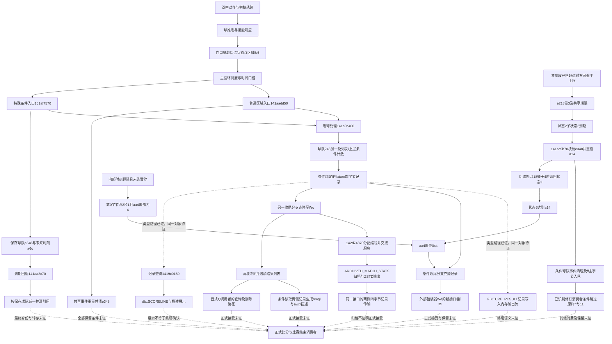

# FM24 机制研究地图

当前目标：闭合一条“有效进球与比分状态”路径。目标版本为Windows FM24 `24.4.2+2081827`，静态原程序和资源是本阶段新增证据来源；不运行游戏、不用第三方编辑器。研究项目与 FastFootballManager 分开，研究未知项不以自研规则填空。

本地图只收敛当前决策需要的机制，历史报告继续保留；[EVIDENCE_INDEX.json](EVIDENCE_INDEX.json)记录每条索引结论的输入、输出、地址、证据、上下游与未证环节，[OPEN_QUESTIONS.md](OPEN_QUESTIONS.md)决定下一项应查的证据。索引不是对全部历史结论的认证，也不以文件数或地址数衡量进展。

## 当前优先级

| 顺序 | 问题 | 已证边界 | 下一步 |
| --- | --- | --- | --- |
| P0 | 有效进球与比分生命周期 | 球门穿越→区域，条件分派→球队计数，保存引用→回退，共享清理→部分保留路径 | 已绑定默认/注册fixture布局；已证比分展示及0x4门槛下的结果副本交接，已证状态3期限/超限置位，已接状态2条件清引用入口，已补一处剩余机会判定及构造延迟，已条件绑定球队清理及事件ff末段，已接队列修订消费者及另一分支的服务交接，已绑定ARCHIVED_MATCH_STATS归档输出，已分清结果列表、描述消费与复制前入口完成位，已排除空列表及单一类型9/完成位保持路径的计分改写，已接9→6顺序效应和两类条件保留边界，已绑定FULL拥有者和结果指针驱动的批量游标，已接批量回调及GAME_UI对同一副本的再次覆盖，已定位ACTUAL_COMP→LEAGUE_STAGE记录累计候选，已接COMP_MANAGER的结果索引写入与赛事分派候选及查询克隆，已定位O+8工厂赋值、GAME_COMP_MANAGER派生分派及保持条件下的读写索引身份，已绑定额外消费者PLAYER_STATS_MANAGER及局部比分读取，已证1427336e0现有表现对象/同日返回整段只读，已绑定PRESS_CONFERENCE_QUESTION消费；已接同一S+98条目排序、规则0/1比较及条件E+e1位置写入，已证登记列表可含调用方栈槽，按值重定向/按槽地址注销，不能当正式拥有者；已接F到双方球队摘要及FIXTURE_RESULT第一侧记录符号位状态、查询第8参数条件排除；优先追真实待赛调度对该参数的绑定和F/K身份保持，补摘要清理虚析构/后续替换及实际消费者语义；累计→排序调度暂缓 |
| P1 | 属性—动作—结果 | 多个局部门槛、评分、球轨迹连接；效果依赖上下文 | P0关键链补齐后固定动作/局面做局部敏感性证明 |
| P2 | 电脑转会成交 | 候选池、筛选、重评分及排序 | 从最终候选消费者追正式报价、卖方接受及合同，不重新铺候选池 |
| P3 | QME | 原生统计资源与部分入口 | 独立追快速比分生成，避免与详细引擎混合 |

## P0 因果图

实线仅表示已有报告中的条件连接；连接条件仍须查正文。虚线为尚未闭合，不代表发生顺序已证。

“动作→球推进”等上游连接仅覆盖已研究动作及条件，不涵盖所有足球事件。主循环在a6c相等时改走事件入口，不能把该次回退与同一普通区域调用点同时执行；跨tick与事件入口内部是否再次改分，仍未闭合。

## 如何阅读证据

- 原始字节核实：仅确认指定地址的字节、指令与局部边界。
- 局部公式恢复：明确输入、截断、类型、条件和输出，不推出比赛频率。
- 生产者/消费者连接：要求对象身份、参数和条件均有证据，不能只靠字段同名或偏移相同。
- 完整因果闭合：还须覆盖选定路径上的保留/撤销条件，并接到已确认的正式结果消费者。
- 仅属推断或未解决：保留替代解释与补证目标，不能自动提升。

本阶段未达到“最终比分端到端闭合”。[综合结论](20261017_有效进球与比分状态生命周期.md)区分已回答、部分回答与未解决。局部验证命令见该报告及README；它不执行游戏，也不产生比赛级实证结论。

## 原始材料的保存

新增公开证据优先保留支撑当前结论的最小指令片段、自行编写的机制说明和复核脚本；完整工作导出留在本地研究缓存。已有大段导出本轮不批量移动或删除，避免破坏历史引用。后续如要迁移，需先确定仍依赖它们的结论与可用替代材料。本轮不为无实际判断用途的文件增设哈希或指纹。
