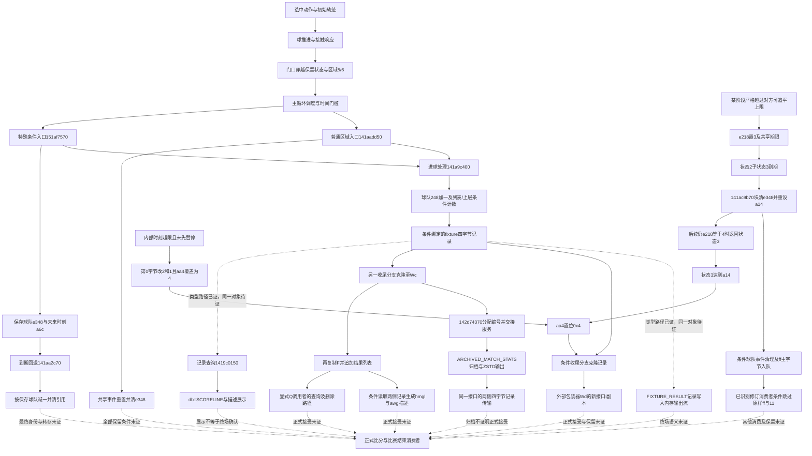

# FM24 机制研究地图

当前目标：解释一次射门为什么能进球。目标版本为Windows FM24 `24.4.2+2081827`，只分析静态原程序和资源，不运行游戏、不用第三方编辑器。研究项目与 FastFootballManager 分开，研究未知项不以自研规则填空。

## 当前射门研究入口

[射门到进球机制研究](20261026_射门到进球机制研究.md)维护当前边界及断点。优先追普通非头球候选请求 `0x36`、实际纠正为 `0x3f` 的路径：属性/上下文→目标与速度/旋转→试算球提交→正式球复制→防守及物理推进→门线/规则→进球处理。已补同调用重新选择的返回链及一条保留动作/速度/旋转的条件分派路径；仍缺上游同时建立这些条件、提交副作用及同一自然轨迹的防守连续性。预测查询会推进球，门线结果另须等待当前时钟门槛，不能按纯读取或预测已进球解释。

下文优先级、P0图和索引描述此前“最终比分生命周期”任务的证据与未完成项，保留供查阅；不再要求先闭合正式赛程接受或数据库引用，才研究射门进球。

候选生产补证：普通追加会清零记录 `+84`，历史 `0x90` 及指定标志会把请求动作 `0x36` 改为 `0x3f`。当前优先追真实产生的子类及零值保持，不把 `0x36` 冻结分派路径误当自然重选已闭合。

最新边界：限定的空区间/已准备球路径已把候选保持推进到追加返回；3f的目标辅助调用已有写入域证据，数值求解按有效模式分流。另已连 `A→S速度/旋转→T初始化→必要预测`，以及正式球复制后实际清控制引用的写入点。已补 S→B 的限定字段交接、球队表映射与不触发析构的引用计数路径。剩余工作是这些前提的同状态建立、复制前后辅助调用、防守/碰撞及规则消费的连续性；其中1443941a0可同步调用144395230，已补实际1fae在空历史/已准备容器及固定池条件下的保留路径，不能把其他路径视为仅入队；另已条件排除复制后三处具体虚回调，补载荷记录及全员缓存采样，将复制后保留连接至144454623释放检查点；另已补正数推进预算与停止传播，停止状态保持时可接到记录入口；已分清记录模式0绕过本体预测、保存上下文与附加增量；另已在准备表/池、时序标志、首次malloc成功及明确CRT行为条件下连接首个原生type15、模式0上下文保持和同一新记录的首次载荷扩容至141abcb2a；自然前提、未停止状态的实际推进及后续记录消费者仍未闭合，详见索引 `shot_execution`。

本地图只收敛当前决策需要的机制，历史报告继续保留；[EVIDENCE_INDEX.json](EVIDENCE_INDEX.json)记录每条索引结论的输入、输出、地址、证据、上下游与未证环节，[OPEN_QUESTIONS.md](OPEN_QUESTIONS.md)决定下一项应查的证据。索引不是对全部历史结论的认证，也不以文件数或地址数衡量进展。

## 当前优先级

| 顺序 | 问题 | 已证边界 | 下一步 |
| --- | --- | --- | --- |
| P0 | 有效进球与比分生命周期 | 球门穿越→区域，条件分派→球队计数，保存引用→回退，共享清理→部分保留路径 | 已绑定默认/注册fixture布局；已证比分展示及0x4门槛下的结果副本交接，已证状态3期限/超限置位，已接状态2条件清引用入口，已补一处剩余机会判定及构造延迟，已条件绑定球队清理及事件ff末段，已接队列修订消费者及另一分支的服务交接，已绑定ARCHIVED_MATCH_STATS归档输出，已分清结果列表、描述消费与复制前入口完成位，已排除空列表及单一类型9/完成位保持路径的计分改写，已接9→6顺序效应和两类条件保留边界，已绑定FULL拥有者和结果指针驱动的批量游标，已接批量回调及GAME_UI对同一副本的再次覆盖，已定位ACTUAL_COMP→LEAGUE_STAGE记录累计候选，已接COMP_MANAGER的结果索引写入与赛事分派候选及查询克隆，已定位O+8工厂赋值、GAME_COMP_MANAGER派生分派及保持条件下的读写索引身份，已绑定额外消费者PLAYER_STATS_MANAGER及局部比分读取，已证1427336e0现有表现对象/同日返回整段只读，已绑定PRESS_CONFERENCE_QUESTION消费；已接同一S+98条目排序、规则0/1比较及条件E+e1位置写入，已证登记列表可含调用方栈槽，按值重定向/按槽地址注销，不能当正式拥有者；已接F到双方球队摘要及FIXTURE_RESULT第一侧记录符号位状态、查询第8参数条件排除；已接实际1434341d3启用第8参数、同候选进入1434ef590及推进后B+20收集生产者；已补FULL选择器早分支及X+58先填充/X+10后克隆顺序；已证14513b9b0空Q+138整次调用保分但自然可达性未证，非空分支M显式转交受A+1db0 bit0控制；已证置位分支新建产物必经141a44b80重建，不能借用缓存命中；已接临时事件缓冲区到141a76920及case1的+248读取，已核对标量转换叶函数及目标记录合并写入；已绑定标准库导入并限定无池/首次分配成功路径，已排除7处固定掩码球员读取并恢复历史去重边界；池补充/失败虚回调、输出增长及其他直接M消费者仍待证；已接141a63a60的38/3a分派和资源查询共享写入，已条件排除字段转移及源清理副作用，已接嵌套构建及两条清理规则，已绑定翻译变量池及归零调用，输出期间原持有者保持/回调副作用未闭合；已条件连接输入F的双方比分→配置增量→同S98的E+c主排序键→E+e1位置写入/读取；复制别名、141ac8820和提交后修订仍未闭合 |
| P1 | 属性—动作—结果 | 多个局部门槛、评分、球轨迹连接；效果依赖上下文 | P0关键链补齐后固定动作/局面做局部敏感性证明 |
| P2 | 电脑转会成交 | 候选池、筛选、重评分及排序 | 从最终候选消费者追正式报价、卖方接受及合同，不重新铺候选池 |
| P3 | QME | 原生统计资源与部分入口 | 独立追快速比分生成，避免与详细引擎混合 |

## P0 因果图

实线仅表示已有报告中的条件连接；连接条件仍须查正文。虚线为尚未闭合，不代表发生顺序已证。

“动作→球推进”等上游连接仅覆盖已研究动作及条件，不涵盖所有足球事件。主循环在a6c相等时改走事件入口，不能把该次回退与同一普通区域调用点同时执行；跨tick与事件入口内部是否再次改分，仍未闭合。

## 如何阅读证据

- 原始字节核实：仅确认指定地址的字节、指令与局部边界。
- 局部公式恢复：明确输入、截断、类型、条件和输出，不推出比赛频率。
- 生产者/消费者连接：要求对象身份、参数和条件均有证据，不能只靠字段同名或偏移相同。
- 完整因果闭合：还须覆盖选定路径上的保留/撤销条件，并接到已确认的正式结果消费者。
- 仅属推断或未解决：保留替代解释与补证目标，不能自动提升。

本阶段未达到“最终比分端到端闭合”。[综合结论](20261017_有效进球与比分状态生命周期.md)区分已回答、部分回答与未解决。局部验证命令见该报告及README；它不执行游戏，也不产生比赛级实证结论。

## 原始材料的保存

新增公开证据优先保留支撑当前结论的最小指令片段、自行编写的机制说明和复核脚本；完整工作导出留在本地研究缓存。已有大段导出本轮不批量移动或删除，避免破坏历史引用。后续如要迁移，需先确定仍依赖它们的结论与可用替代材料。本轮不为无实际判断用途的文件增设哈希或指纹。

2026-10-20补证：[比赛记录初始化](20261020_比赛比分初始化与普通记账起点.md)已定位实际FULL调用中的双方R[0]=0及mode2的R[3]→T+11b；其后准备/比赛/收尾的保留与正式结果闭环仍未完成。

2026-10-20收敛：[空槽文本求值与计分隔离](20261020_空槽文本求值与计分隔离边界.md)排除实际38/3a输出参数0、空槽的已定位虚调用；已将字符串归零和池回收恢复为原始存储管理。保留有效存储、首次分配成功/池已初始化等条件，尚未证明源资源缓存全生命周期及完整产物保分。另已补双方球队构造中T+11b=0、T+248清零与M+cdf8/ce00发布，见初始化专项。

2026-10-20赛事侧：[脏标志与同阶段排序调度](20261020_赛事脏标志与阶段正式消费.md)已接到独立40字节记录追加；原生池标签TC_LEAGUE_HISTORY将该输出绑定为球队赛事历史，不能作为当前赛程最终接受。正式索引消费者与跨回调保分继续研究。

2026-10-20收尾侧：[只读辅助与球队处理边界](20261020_收尾只读辅助与球队处理边界.md)已整体排除141ac8d90及141abbdd0改分，并条件绑定141ac9190的fixture+d0/manager+20查询。合格球员处理已接只读比较、case2局部写及事件入列；历史拥有关系、其他有效索引调用、其余回调与之后的修订仍有明确缺口。

2026-10-21正式消费端：[20261021_当前联赛比分消费与排序.md](20261021_当前联赛比分消费与排序.md)连接输入F到当前原阶段球队行的累计、默认排序主键及位置读取，区别TC_LEAGUE_HISTORY输出。它是给定F被当前联赛采用的限定终点，尚未证明自然射门和所有前后修订/保留条件。

2026-10-21事件边界：[收尾事件记录](20261021_收尾事件记录与保分边界.md)将公共提交展开到唯一10字节追加与池补充；无即时足球裁定调用，但恢复虚回调、实际参数/所有权和后续消费者仍待证。

2026-10-21非零条件：[非零条件查询与收尾保分](20261021_非零条件查询与收尾保分.md)补足实际mode3评分/候选排序/值清理子树；0.93/0.80比较只写栈flags。完整非零路径的保分从未知推进到明确条件，不能由R6c非零推出自然候选非空或后续消费者保分。

2026-10-21状态队列续证：见[球员状态评分与队列应用保分](20261021_球员状态评分与队列应用保分.md)。此前141b2a230完全未展开的边界已更新：六种实际高位码的两次不同参数评分、caller-stack条件集合和类型1队列应用已条件保分；Q+18=1保持到151bfe98a，可排除该路径消息尾跳。141b2b470可在逐次非零查询/身份/正常存储条件下整体保分；自然条件建立、1443b04f0其他调用及同一F正式采用仍是阻断，不宣称最终比分闭环。

2026-10-21候选非空续证：见[候选非空条件与标志直接消费](20261021_候选非空条件与标志直接消费.md)。实际空向量mode3在正常返回/缓存保持条件下非空，当且仅当P388索引0、2..14至少一项signed>=10；14类均有零门槛见证。141b2b98f/141b2ba76只检查EAX低位，不消费新增位33/34。自然属性载入到同一P、每次查询前条件建立/保持仍未证明；构造前缀的零写及R6c配置非零均不能替代。不扩大到全部flags消费者或最终比分闭环。

2026-10-21位置来源续证：见[位置区流传输与上限截断](20261021_位置区流传输与上限截断.md)。MATCH_PLAYER虚表方法把P280+108=P388交给69字节流接口；其后15个signed上限截断保留而不建立候选非空条件。实际141b5e0b9调用及141a829d0复制前缀另连接同一69字节区；只证明前缀条件保持。实际输入流接收者、源记录建立条件及同一P到查询的时序仍未闭合。

2026-10-21FULL来源续证：见[FULL构建器位置输入来源](20261021_FULL构建器位置输入来源.md)。实际1451a9b33把球队槽中的P280传给GAME_MATCH_BUILDER virtual+a0→14519e490；14519f7a5从人员接口virtual688所获D的virtual320结果复制69字节到P388。两类数据库球员主虚表的320均为返回D208的叶函数。已接复制检查点，仍缺真实人员动态绑定、源位置E建立及复制后同一P到查询保持；不把输入来源连接当自然非空或比分闭环。

2026-10-21条件建立续证：见[数据库位置非空条件建立](20261021_数据库位置非空条件建立.md)。142179240的14217b8ac..8f3检查signed位置0、2..14是否>=15，无合格项就写索引12=20；在检查点主动建立候选所需E。已接两处真实调用，143623630先构造ACTUAL_PLAYER并把同一D传入。保证止于检查点；14217e290等尾部调用、D发布至比赛人员引用、复制后P保持及所有存档加载覆盖仍未证明。

2026-10-21生成末段续证：见[生成末段位置条件保持](20261021_生成末段位置条件保持.md)。14217e290的人员/合同/日期有限虚调用已绑定到两类球员及七类合同；19槽及非位置写入已核对。在限定正常类型/所有权/稳定分配器条件下，H从14217b8f3保持到142179240正常返回。下一1426bda50边界见下条续证；其余外层处理、返回人员U的发布及同一D进入FULL复制仍待证；人员成功返回接口形状相容不等于同一实例采用。

2026-10-21外层字段续证：见[外层字段处理与位置条件保持](20261021_外层字段处理与位置条件保持.md)。实际143624b03调用的9个虚槽、14处n=8分布和20项跳表已核对；在ACTUAL_PLAYER布局/正常存储/稳定分配器条件下保持前15位置字节，允许A[62]/A[66]写入。若调用者[RSI+3c]!=0跳过143624add初始化，可把前序H连续推进至143624b08；初始化分支仍未证明。下一步追b08后外层处理和U发布到P+28，不能将这一帮助函数边界当成整个工厂返回或自然比分闭环。

2026-10-21后续重算边界：见[工厂后续位置重算与修正边界](20261021_工厂后续位置重算与修正边界.md)。142435270在实际ACTUAL_PLAYER/稳定TLS条件下保持前15位置；前序14365b210的选择器/关系子树未闭合。更后面的1438f1890实际分支把D208传给14274b3b0→1419d1fd0，写回包含位置区，再叠加D188修正。下一优先证明实际重算的H后置条件和修正记录生产/空引用条件；整体连续检查点仍143624b08，不把后重算局部尾部反例当自然游戏反例。

2026-10-22修正引用起点：同一[重算边界报告](20261021_工厂后续位置重算与修正边界.md)补接ACTUAL_PLAYER构造器14216b690/69b的跨边界清零，证明D188在14216b6a6为空；后续填充/替换及重算入口保持仍待证。

2026-10-22位置重算续证：见[位置零权重与修正往返条件](20261022_位置零权重与修正往返条件.md)。实际有效j/非空权重表/param5=0给出前15零权重，内层跳过对应short，范围内写回保持其值；若x-delta在1..100且前后同一修正，最终恢复原H见证。构造空引用须保持至准备快照，或证明自然修正生产的范围与稳定性；此前选择及其余工厂调用仍未闭合，不能把局部尾部下降当作整个往返下降。

2026-10-22服务同日续证：见[球员服务绑定与同日返回](20261022_球员服务绑定与同日返回.md)。已接工厂键/RTTI、S8返回到主对象减8及virtual298→144b62b30；实际1438f1d57传R8W=1，缓存日期与当前日期相等时在D写入前返回。构造D150保存当前值已有直接指令；中间日期/修正引用保持、其他服务路径及自然对象连接仍待证。

2026-10-22服务前续证：见[服务前标量与延迟缓存边界](20261022_服务前标量与延迟缓存边界.md)。实际143919b30及D1c0回写保持位置/日期/修正；另一实际查询的virtual218绑定144b58430，在已初始化空闲池路径创建独立a8h缓存并只新增D108引用。新缓存首尾均0；不是mode3候选非空证明。查询后段、实际1421983f0(D,mask,0,1,0)及143913940接收球员的子调用仍待证，连续H检查点不升级。

2026-10-22实际回退续证：见[实际零上下文候选回退保持](20261022_实际零上下文候选回退保持.md)。真实R8D=0/R9B=1排除另两条评分路径；已绑定virtual468为只读signed位置门槛查询，类别默认掩码最高索引52落在已初始化53项表内。复用既有只读分类器后，整次fallback在明确共享表/存储条件下保持D150/D188/A69；父查询、后续向量及自然对象连续性仍待证，连续H检查点不升级。

2026-10-22包装器后段续证：见[候选包装器返回后段保持](20261022_候选包装器返回后段保持.md)。1419cf110的输出地址为实际栈字节，重定位位掩码帮助函数只操作寄存器；复用完整byte vector增长证据，把1439138ac至RET连续条件保持。整个143913870仍缺前置14390f9d0，尤其virtual778/1449a8600；不升级自然H或正式比分闭环。

2026-10-22整个包装器续证：见[前置查询与整个候选包装器保持](20261022_前置查询与整个候选包装器保持.md)。virtual778绑定返回D170地址，D178列表查询在实际四个可选输出为空时只写局部mask/payload，唯一帮助函数为重定位只读表查询；前置查询完整指令与后段合成整个143913870条件保持。下一项上层143913940；共同条件的自然连续性仍未证明，连续H仍143624b08，最终比分未闭合。

2026-10-22上层记录续证：见[记录浮点消费者与球员写入隔离](20261022_记录浮点消费者与球员写入隔离.md)。三组基础/标志/向量消费者的输出接到局部11-float区，补齐两张五项表、只读类别映射和非空输入的临时分配路径；在既有条件下排除目标D字段写入。上层type3及共用1438c7810和特定上下文查询仍未证，不升级全聚合器或自然H。

2026-10-22人员查询续证：见[人员状态返回域与上下文分支排除](20261022_人员状态返回域与上下文分支排除.md)。person400的七类合同88查询闭合；实际person598(mode1)允许上下文R2c缓存写，在固定有效合同及稳定重复d0条件下AL仅0/1/3，故1438c79a3的142223940不可达。末段144eb2770只写栈标记；仅LOAN的90为真可能进入142133540。整个解析器仍缺1438f6250/1438f0760及动态接收者，自然H及比分闭环不升级。

## 2026-10-22 上下文解析路径收敛

见[20261022_上下文解析零返回与重定位写入边界](20261022_上下文解析零返回与重定位写入边界.md)。直接记录X28!=44、X80非空且绑定ACTUAL_PLAYER时，1438f6250整次返回0，实际调用者保留B并跳过1438f0760；前序非LOAN条件仍需成立。另一路1438f0760实际将B/P传给14286c520，重定位体15475c552含8字节全局ADD，不能按只读处理。下一步绑定1428c7a00返回对象及virtual698，验证自然记录能否进入有限已证路径。连续H仍止于143624b08，正式比分未闭环。

## 2026-10-22 已有记录查询与接口边界

见[已有上下文命中与人员接口返回](20261022_已有上下文命中与人员接口返回.md)。实际aa已有记录命中、干净注册表、三类人员210/698已连接成限定保持路径，覆盖X80为空的一类回退。下一步追已有aa记录/注册表生产和1428c84d0→1428c8880/1427796c0/14277aca0，禁止以非空返回代替动态类型和接口身份。连续H仍为143624b08，比分未闭环。

## 2026-10-22 注册表位置条件建立入口

见[注册表球员到位置生成入口](20261022_注册表球员到位置生成入口.md)。V68/S80槽Q→1423e9120的实际6b8→同D→142179240(arg4=0)提供另一条真实H建立入口。6a8/738返回D2a0而非空，不得跳过帮助调用。下一步优先生成后段和同Q发布到比赛的关系；不无目的扩大人员回退检索。原工厂连续H仍止于143624b08，本路线仅到已有建立/生成返回条件边界，最终比分未闭环。

## 2026-10-22 注册表生成后段收敛

见[注册表生成后段的位置保持](20261022_注册表生成后段的位置保持.md)。在ACTUAL_PLAYER、已有独立缓存或冷年龄<28、已解析关联记录及ready/no-flush池条件下，真实累计/缓存整理/节点删除/合同更新保持前15位置，替代路线H可到1423e9120正常返回。不是自然条件建立；下一步优先同一Q注册/发布至FULL，只有选定路径要求时再扩展冷年龄>=28、B_CLUB或ID解析。原新球员工厂连续H仍止于143624b08，比分未闭环。

## 2026-10-22 FULL人员引用发布

见[FULL人员引用发布与名单槽](20261022_FULL人员引用发布与名单槽.md)。实际循环CFG→B.virtual88→名单Dprime→personQprime→P28首次写入已连接，先前“P28写者未知”收敛为B90/B140名单生产、其Dprime与注册表D的同一性、provider首次写后到返回及到69字节复制的连续保持。不得只凭同类型/同偏移升级实例等同；自然输入和比分仍未闭环。

## 2026-10-22 FULL名单生产与服务边界

见[FULL名单生产与过滤服务边界](20261022_FULL名单生产与过滤服务边界.md)。B90/B140生产已定位到virtual70/145193a50的两处144c3e950调用；合格候选直接复制原指针，flags3时缺项可查注册表替代。过滤virtual3f8实际先调用服务298，不能按纯getter处理。下一项证明同一注册表D进入T48候选及过滤时日期/位置保持，再追完整选人、virtual78和virtual88后段；原工厂与注册表路线的连续H检查点均不升级，比分未闭环。

## 2026-10-22 生成与回退的注册表绑定

见[注册表拥有者绑定与回退索引边界](20261022_注册表拥有者绑定与回退索引边界.md)。调度case7实际传V=14642ecd0，V68就是FULL回退读取的14642ed38；限定S80路径可在存储/槽稳定及有效k条件下读同一Q/D。1448dd860实际通过1448d7a30的result38或ffffffff返回索引，成功/范围及注册替换未证。进一步已接回退新增VIRTUAL_PLAYER与U30注册；主320经1448de620取得另一对象+208作属性源。下一项追U38索引生产及解析对象的位置条件，不把同一全局地址当跨时间同一球员或H保持。正常候选3f8服务及后续名单/复制保持仍待证，比分未闭环。

## 2026-10-23 虚拟球员注册与位置建立

见[虚拟球员注册索引与位置建立](20261023_虚拟球员注册索引与位置建立.md)。无扩容、正唯一键及S5c bit0清零路径把S80追加槽与U38=k连接；缓存命中按U1c/键返回既有D，未命中可构造ACTUAL_PLAYER。服务30返回0分支的1448e09e2调用完整无CALL位置设置器，低5位10h时主动写A12=20，建立H/E至1448e09e7。下一项优先后段实际14274b3b0(A,D,D,0,ff,0)及其他帮助调用，证明解析器返回保持；自然对象/注册连续性及比分未闭环。

## 2026-10-23 虚拟解析器重算前保持

见[虚拟属性解析器重算前的位置保持](20261023_虚拟属性解析器重算前的位置保持.md)。已完整展开查询尾跳、条件virtual40、person230和随机辅助，在实际类型/TLS-ready/有效存储条件下，H从1448e09e7连续保持到1448e0a94调用前；允许非空查询与正结果写D14e。U20h置位另有直返同D条件结论，但自然标志来源未证。下一项集中实际14274b3b0的位置选择/修正及后续1419cafd0，不重做已闭合前缀；比分未闭环。

## 2026-10-23 门将普通重算到FULL复制

见[门将位置重算到FULL复制的条件链](20261023_门将位置重算到FULL复制的条件链.md)。mask4主动写A0=20，空D188及有效权重/缓存条件下，普通实际重算直接选j0，复用零权重/写回与只读评分证据，可到解析器同D返回、VIRTUAL320再到FULL复制检查点14519f7aa，P388[0]=20/E成立。不是借20h直返绕过重算；自然U码、D188保持空、名单身份与复制后至查询的保持仍未证。下一项集中这些实际前提，非门将/非空修正不升级，比分未闭环。

2026-10-23续证：[再生服务派生绑定与左右脚写入边界](20261023_再生服务派生绑定与左右脚写入边界.md)确认全局再生服务为派生对象+18h子接口，virtual30实际筛选模板，不能借用基础类常零；零返回分支的清属性/左右脚计算/缩放/位置设置保持D188，将空修正前提前移至1448e0942。更早接收D的调用、派生服务自然返回0及复制到查询的保持仍未闭合。

2026-10-23续证：[再生查询保持与门将模板双分支](20261023_再生查询保持与门将模板双分支.md)在分配器就绪、无池、首次分配成功及实际人员/上下文条件下，闭合派生查询的D188/A69保持；非空模板门将分支只填后54项，和零分支共同到1448e09e7。限定起点前移至1448e074c，不再要求服务返回0。下一项追更早virtual40→143660a40及关联写入，空修正自然连续性、存储条件和复制至查询的生命周期仍未证。

2026-10-24续证：[上游上下文调用与关联容器写入边界](20261024_上游上下文调用与关联容器写入边界.md)确认实际再生virtual40传上下文RDI而非直接D；已接第一条无CALL成功分支，其他间接副作用仍未知。真正接收D的关联子调用经+78/-20两次调整访问D2f8，已条件覆盖空容器创建和首条追加并保持D188/A69；下一项优先14240d540及实际辅助查询，再合成整个144983df0。未证明构造至1448e074c空修正、自然存储或比分闭环。

2026-10-25续证：[上下文转换与关联处理整段保持](20261025_上下文转换与关联处理整段保持.md)在有效上下文、注册表索引无需整理、ACTUAL/VIRTUAL人员及入口空D2f8/既定存储条件下，闭合实际1448df083→144983df0→1448df088整次D188/A69/U1e保持；允许真实创建首条关联。未靠参数4=0或U200清零跳过分支。另已覆盖非空列表的实际142879710(L,1,0)及无CALL后段，将门将空修正前提前移到1448e0264；下一项集中df088至e0264的区间缺口，再补构造后D188/D2f8连续性；自然比分仍未闭环。

2026-10-25中段收敛：见[中段控制流与实际查询边界](20261025_中段控制流与实际查询边界.md)。原PE独立CFG排除互斥排序支路；CLUB查询、冷缓存生产与阶段元素初始化获得限定证据。四处实际调用的自然前提及同一对象生命周期仍开放；优先检查普通CLUB关联的D128清零保持，避免在实际不可达的国家队缓存子树继续扩展。比分未闭环。

2026-10-25上下文输入续证：见[上下文早返与数据库候选输入](20261025_上下文早返与数据库候选输入.md)。完整恢复getter和ID布尔分派；普通CLUB不会一概早返。随附client_db中普通tag0的Ajou University记录C+c=214eb，与只读集合命中一致；d8/e8原值80是引用槽值，国家槽80候选稳定ID135。已连接原生读者/字段及管理器国家表构造，仍未证明实际载入模式、引用修正/注册阶段保持、同一C/R在物化器调用时被采用及返回后控制流。不能用资源记录存在替代自然比分路径证明。
